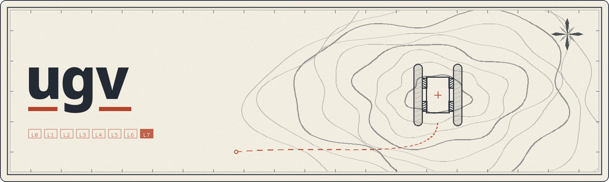

<p align="center"><i>A small mecanum car that parks itself under a drone, from simulation to the floor.</i></p>

<p align="center">
  <a href="https://github.com/uOAeronautics/ugv/actions/workflows/ci.yml"></a>
</p>

<p align="center">
  <a href="docs/COMMANDS.md"><b>Commands</b></a> ·
  <a href="docs/SAFETY.md"><b>Safety</b></a> ·
  <a href="docs/POSE.md"><b>Pose plan</b></a> ·
  <a href="docs/L7_FIELD_NOTES.md"><b>Field notes</b></a> ·
  <a href="docs/INDEX.md"><b>All docs</b></a>
</p>

---

# UGV

A Freenove `FNK0043` 4WD mecanum car on a Raspberry Pi 4B (`ugv-dashboard.service`, port `8765`) that should park itself under the STRL-001 airframe. Current direction (2026-11-17): estimate the airframe's 6-DoF pose from the car camera with its 3D model and synthetic data, then park with a declared state machine. Plan: [docs/POSE.md](docs/POSE.md); what was tried before, including the retired 2D RL stack: `research/attempts/`.

**[Commands](docs/COMMANDS.md)** · [Pose plan](docs/POSE.md) · [Safety gates](docs/SAFETY.md) · [Hardware](docs/HARDWARE.md) · [Network & SSH](docs/NETWORK.md) · [Field notes](docs/L7_FIELD_NOTES.md) · [All docs](docs/INDEX.md)

## Status

| Area | State | Source |
|---|---|---|
| Parking in simulation | 909/1000 parked (95% CI 89-93%), 7 collisions (`config/park_params.json`), over randomised cars, cameras and starts; the 3D mesh defines the bay | [docs/PARK_SIM.md](docs/PARK_SIM.md), `uv run ugv-lab` |
| Pose from the 3D model | Synthetic smoke test: PnP on 12 true keypoints with 1 px noise lands within 5 deg / 10 cm on every solved view; SIFT bank as first set up fails (0/40). No real frames yet | `research/attempts/2026-11-17-pose-smoke-*` |
| 2D RL parking (retired) | Best sim student 966/1000 at L1, 0/3 parked on the car | `research/attempts/2026-11-17-track-2d-rl.md` |
| Hardware (Pi 4B) | Classical go-to reached its target 4/4; ArUco + KLT decodes 97% while moving | [Field notes](docs/L7_FIELD_NOTES.md) |
| Real plant | 2.3 m/s forward, ~1.6 m/s strafe, 15.7 rad/s yaw per duty; deadzones 0.05 / 0.13 / 0.10 | [Field notes](docs/L7_FIELD_NOTES.md) |

Open work and its order: `uv run python tools/research/ledger.py roadmap`.

## Layout

| Path | Contents |
|---|---|
| `src/ugv/` | Torch-free Pi runtime: FastAPI/WS dashboard (`web.py`), ArUco + KLT vision, BMI270 IMU heading, `swept_clear` shield, state machines (`fsm.py`) |
| `src/ugv/pose/` | Airframe mesh and keypoint skeleton, synthetic renderer, PnP and SIFT pose |
| `src/ugv/park/` | Parking simulator and the state-machine controller |
| `src/ugv/lab/` | Lab dashboard: park results and tuning, 3D parking challenge with the live controller, pose views, ledger (`uv run ugv-lab`) |
| `train/` | GPU training of the keypoint detector (own environment) |
| `src/ugv/research/`, `research/`, `tools/research/` | Decisions, attempts and tasks (one Markdown file each) and the `ledger.py` CLI |
| `simulation/gazebo/` | Gazebo 3D car/drone/lab worlds, native `ugv::TTMotorSystem` plugin, camera/IMU models, and browser drive console |
| `arduino/` | Standalone Nano 33 BLE Sense Rev2 firmware (`firmware/MotionStream`), BLE streaming, and VQF dashboard |
| `tools/` | Pose smoke test (`tools/pose/`), ledger, L7 field harness (`tools/l7/`), calibration (`tools/calibration/`), mesh optimisation |
| `docs/` | Topic documentation indexed in [docs/INDEX.md](docs/INDEX.md) (state, safety, network, commands, pose plan, field notes) |
| `tests/` | Root torch-free unit and dashboard tests (`pytest` also covers `simulation/gazebo/test_*.py`) |

## Setup

Root Python `>= 3.13` stays torch-free for Pi deployment. Pose training (when it starts) gets its own CUDA environment, as `rl/` had.

```bash
uv sync
uv run ugv --help
uv run ugv-dashboard                 # FastAPI/WS dashboard on port 8765
uv run pytest -q                     # root + simulation/gazebo tests
./simulation/gazebo/launch_control.command   # Gazebo + local console on :8767
```

- **Lab dashboard**: `uv run ugv-lab`, then open http://127.0.0.1:8768 (try the Challenge page).
- **Parking simulation**: `uv run python tools/park/eval.py --name default --sweep`; see [docs/PARK_SIM.md](docs/PARK_SIM.md).
- **Pose smoke test**: `uv run python tools/pose/smoke.py --views car --out runs/pose_smoke`; see [docs/POSE.md](docs/POSE.md).
- **Arduino IMU companion**: standalone BLE + VQF orientation dashboard on port `8766`; see [arduino/README.md](arduino/README.md).
- **Docs & safety**: check [docs/SAFETY.md](docs/SAFETY.md) and [docs/STATE.md](docs/STATE.md) before any Pi SSH or motor actuation. See [docs/INDEX.md](docs/INDEX.md) for all documents and [docs/COMMANDS.md](docs/COMMANDS.md) for the canonical command table.

References: [Freenove FNK0043](https://github.com/Freenove/Freenove_4WD_Smart_Car_Kit_for_Raspberry_Pi) · [official docs](https://docs.freenove.com/projects/fnk0043/en/latest/)
